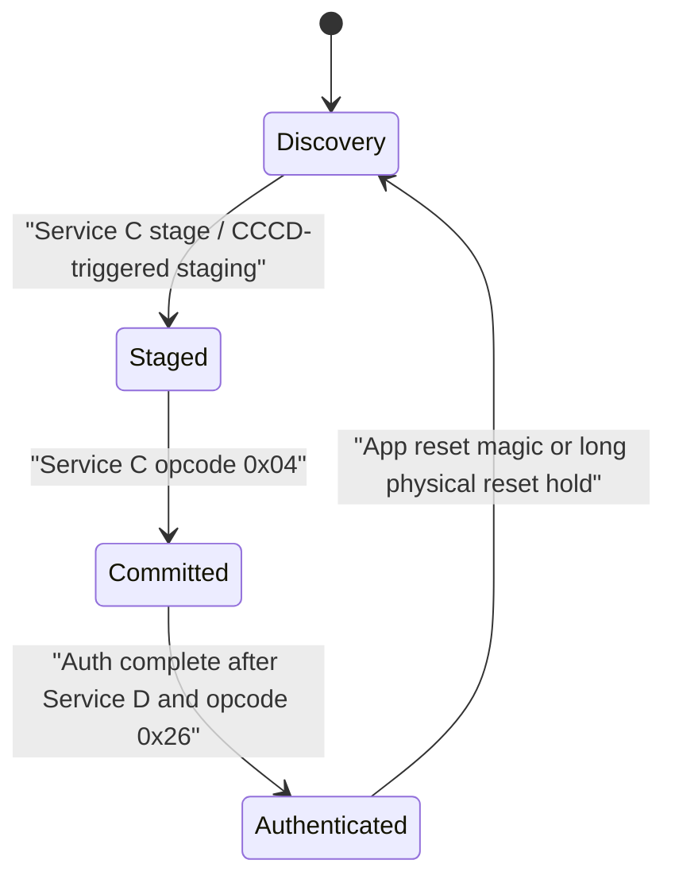
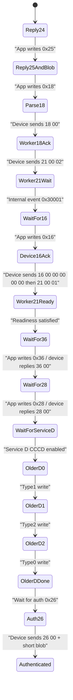
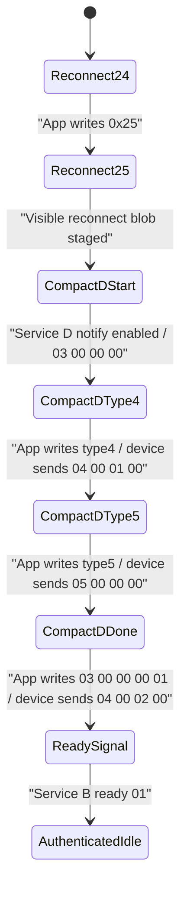

# Service Write-Up

## Purpose

This document describes the BLE services implemented by the working emulator in `code/nrf_emulator/pgpemu_nrf52_plusplus_exp`.

It is written as a data reference. The goal is to describe:

- each service
- the characteristics inside each service
- what each characteristic is used for
- what state it reads or writes
- how the services work together
- the observed order of the full system flow

This write-up is based on the current functional code path and is intended to private file observed protocol data, byte layouts, state relationships, and storage locations.

## Service List

| Service | UUID | One-line description |
|---|---|---|
| Battery Service | `0x180F` | Exposes a simple battery level so the app sees a normal power-reporting peripheral. |
| Service A | `addc3e26-4aa5-4c1a-8a6a-735db4e01c6c` | Mirrors identity and high-level pairing state, including public address and compact readiness bytes. |
| Service B | `2bbe7f7c-7304-4466-8407-8eaf89f8ce45` | Exposes ready-state and pair-state summaries used during post-pair and reconnect behavior. |
| Service C | `6b7f9c98-8588-4624-8a94-38c9bce32685` | Handles pre-auth pairing staging, commit signaling, and the first-pair notify burst. |
| Service D | `bbe87709-5b89-4433-ab7f-8b8eef0d8e37` | Implements the certification gate that blocks pairing until the expected typed exchange succeeds. |
| Service E | `21c50462-67cb-63a3-5c4c-82b5b9939aeb` | Carries LED/effect input, button/status output, version data, and a small config lane. |
| Auth Service | `138c35b6-23a0-459c-9869-acb9228be64f` | Drives the auth control sequence, auth blob transport, reconnect entry, and authenticated sleep export commands. |

## Shared Protocol Properties

Before describing each service individually, the emulator exposes a few shared protocol properties.

### One central state machine

All services are projections of one runtime state model. The device tracks:

- pairing stage
  - `discovery`
  - `staged`
  - `committed`
  - `authenticated`
- pair event class
  - starts as `0x21`
  - becomes `0x23` when staging begins
  - becomes `0x24` when the pair is committed
  - becomes `0x25` after auth completion
- transfer-state byte for Service C
- Service D certification substate
- auth parser state
- auth blob staging state
- reconnect-ready persistence state

The visible services mirror this same state consistently.

### Advertising is part of the protocol

The scan-visible contract observed by the app is:

- public BLE address matches the donor address
- device name is `Pokemon GO Plus +`
- manufacturer payload exists and carries the correct final state byte
- 32-bit service data is `B6 35 8C 13`
- advertising is connectable, scannable, undirected

The manufacturer-state byte is especially important:

- `0x01` means pairable / fresh
- `0x02` means reconnect-ready / authenticated history exists

### Runtime state is mirrored across services

Multiple characteristics are derived from shared state rather than stored as independent copies. Whenever state changes, it refreshes:

- Service A readable address and compact state bytes
- Service B ready-state bytes
- Service C state image
- Service D status bytes
- Service E config byte

This keeps the device state coherent to the app.

### First pair and reconnect are different protocols

They are separate protocol branches.

First pair:

- uses the older Service D lane
- includes real `36` and `28` auth writes
- ends by persisting accepted nonce and Service D state

Reconnect:

- uses the compact Service D lane
- reuses persisted nonce and Service D state
- does not redo the full first-pair `18 -> 16 -> 36 -> 28 -> older Service D -> 26` chain

### Persistence fields

Reconnect uses pairing data stored after a successful first pair.

Persisted fields are:

- paired/reconnect-ready flag
- accepted central nonce validity bit
- accepted central nonce bytes
- Service D selector4 validity bit
- Service D selector4 bytes
- Service D selector5 validity bit
- Service D selector5 byte
- Service D record6 validity bit
- Service D record6 bytes
- Service D record1A validity bit
- Service D record1A value

The persisted record is stored as a binary structure in `/pair_state.bin`.

### Notifications and staging order matter

The app is sensitive not only to values, but to when those values are available.

Two examples:

- Service D read blobs are written into readable storage before the status notify that tells the app to read them.
- the visible auth blob is staged before the notify that exposes it.

Ordering is part of the observed behavior, not just the byte values.

## Battery Service

### Role

Battery Service exists to make the device look like a normal consumer BLE device. It is not part of the auth gate.

### UUID and characteristic

- Service UUID: `0x180F`
- Characteristic UUID: `0x2A19`

### Characteristic behavior

#### Battery Level

- Properties: read
- Length: fixed 1 byte
- Default value: `100`
- Access pattern: the app reads it; the emulator does not use it to drive any state changes

## Service A

### Role

Service A is the identity-facing state mirror. It exposes the donor public address, pairing readiness, committed pair visibility, and a compact status notify lane.

### UUID and characteristics

- Service UUID: `addc3e26-4aa5-4c1a-8a6a-735db4e01c6c`
- Char1: `...c6d`
- Char2: `...c6e`
- Char3: `...c6f`
- Char4: `...c70`
- Char5: `...c71`

### Characteristic behavior

#### Char1

- Properties: write without response
- Length: variable up to short write size
- Behavior: stores whatever the app wrote
- Function: mostly acts as a writable mailbox; current code stores, but no major state transition is attached

#### Char2

- Properties: write without response
- Length: variable up to short write size
- Behavior: stores whatever the app wrote
- Function: same as Char1, mainly preserved to match the real service layout

#### Char3

- Properties: read
- Length: fixed 6 bytes
- Payload: donor public BLE address in little-endian byte order
- Function: identity exposure

Implementation details:

- The runtime refresh path copies the replayed public address into `serviceARead3`.
- The readable value is rewritten whenever pairing exports are refreshed.

#### Char4

- Properties: read
- Length: fixed 8 bytes
- Payload structure:
  - byte 0: readiness code
  - byte 1: committed pair visibility flag
  - byte 2: active pair byte 0
  - byte 3: active pair byte 1
  - byte 4: address byte 3
  - byte 5: address byte 4
  - byte 6: address byte 5
  - byte 7: manufacturer-state byte

This is one of the most important compact state mirrors in the emulator. It gives the app a snapshot of whether the device is still pairable or already in reconnect mode.

#### Char5

- Properties: read + notify
- Length: fixed 2 bytes
- Payload structure:
  - byte 0: readiness code
  - byte 1: pair event class

The emulator also mirrors button-visible state into this lane, because `notifyButtonState()` updates both Service E button output and Service A status output.

### How Service A values are produced

Service A is not independently authored. It is rebuilt by the central export refresh routine.

Runtime derivation rules:

- readiness code
  - `0x00` in discovery or staged
  - `0x01` in committed
  - `0x02` in authenticated
- committed-pair visibility
  - `0x00` before committed
  - `0x01` once committed or authenticated
- pair bytes
  - hidden as `00 00` before committed
  - copied from `activePair` once committed
- manufacturer-state byte
  - copied from the current advertising manufacturer payload final byte

The address exposed in Char3 is display-ordered from the internal little-endian replayed address. The app-visible presentation is different from the internal byte order used for advertising setup.

## Service B

### Role

Service B presents a ready-state and pair-state summary that becomes more important after pairing succeeds and during reconnect completion.

### UUID and characteristics

- Service UUID: `2bbe7f7c-7304-4466-8407-8eaf89f8ce45`
- Char1: `...ce46`
- Char2: `...ce47`
- Char3: `...ce49`

### Characteristic behavior

#### Char1

- Properties: read + notify
- Length: 4 bytes in normal pairing-state mirror mode
- Payload structure:
  - byte 0: readiness code
  - byte 1: active pair byte 0
  - byte 2: active pair byte 1
  - byte 3: pair event class

Special reconnect behavior:

- After compact reconnect Service D completes, the emulator primes Char1 so it remains readable as single-byte `04`.
- The older reconnect-ready single-byte `01` notify is suppressed for Device B parity; sending that extra notify was tied to the low-battery icon behavior.

#### Char2

- Properties: read + notify
- Length: fixed 4 bytes
- Payload structure:
  - byte 0: candidate pair byte 0 if committed, else `00`
  - byte 1: candidate pair byte 1 if committed, else `00`
  - byte 2: committed-pair visible flag
  - byte 3: readiness code

#### Char3

- Properties: read
- Length: fixed 2 bytes
- Payload structure:
  - byte 0: readiness code
- byte 1: pair event class

### How Service B fits the protocol

Service B becomes important in two places:

1. After older Service D completion in first pair
The emulator can temporarily prime a post-Service-D ready state where a Service B read resolves to `04`. This acts like a post-certification ready marker before final auth completion.

2. After compact Service D completion in reconnect
The emulator primes Char1 as readable `04` and suppresses the older one-byte ready `01` notify. This matches Device B parity and avoids the low-battery icon path.

The rest of the time, Service B behaves as a mirror service built from the shared pairing state.

## Service C

### Role

Service C is the pre-auth pairing side channel. It is where the app stages the pair, commits the pair, and sees a realistic first-pair notify burst before the auth lane fully takes over.

### UUID and characteristics

- Service UUID: `6b7f9c98-8588-4624-8a94-38c9bce32685`
- Char1: `68282de6-e643-4caa-a6b4-e96f46ed988a`
- Char2: `290278ac-5eb9-47df-899d-e904ab62b4b3`

### Characteristic behavior

#### Char1

- Properties: write + notify
- Length: variable, up to medium write size
- Runtime storage length: 74 bytes for the main state image

Important opcodes:

- `0x02`
  - sets transfer state to `0x02`
  - changes pair event class to `0x23`
  - stages a candidate pair if still in discovery

- `0x03`
  - sets transfer state to `0x01`
  - uses byte 1 as a small mode/state byte
  - refreshes visible pairing exports

- `0x04`
  - if needed, stages the candidate pair
  - if transfer state is already `0x02` or the device is staged, commits the staged pair

Outside those opcodes, the emulator copies the written payload into the service state buffer and refreshes mirrored state.

#### Char2

- Properties: write without response
- Length: variable, up to medium write size
- Behavior: stores the write
- Function: compatibility lane; current code does not attach major state transitions here

### Service C notify burst

Once the device reaches at least `staged` and the app has enabled Char1 notifications, the emulator schedules a three-step notify burst.

Each 74-byte payload contains:

- header bytes `2c a4`
- a step-dependent subcode
- transfer state
- readiness code
- pair event class
- current manufacturer state
- donor address bytes
- a synthetic filler region derived from the cert block
- a tail step marker

This burst is timed relative to connection start and is used to make first-pair behavior feel realistic enough for the app to continue.

More specifically, the burst payload is constructed as:

- bytes 0..1: constant `2c a4`
- byte 2: `0x20 + burstStep`
- byte 3: current Service C transfer state
- byte 4: current readiness code
- byte 5: current pair event class
- byte 6: current manufacturer-state byte
- bytes 8..13: donor public address
- bytes 14..71: synthetic filler derived from the donor cert block using a step-dependent xor pattern
- byte 72: burst step number
- byte 73: `00`

Burst timing:

- step 1 around 1200 ms after connect
- step 2 around 1650 ms after connect
- step 3 around 1750 ms after connect

The filler is not claimed as the real firmware exact payload semantics. The observed app-visible requirement is a realistic structured notify train while the device enters pair-ready state.

## Service D

### Role

Service D is the certification gate. It is the final major blocker before auth completion and is handled as a typed state machine with two distinct flows:

- older flow for first pair
- compact flow for reconnect

### UUID and characteristics

- Service UUID: `bbe87709-5b89-4433-ab7f-8b8eef0d8e37`
- Char1: `...e38`
- Char2: `...e39`
- Char3: `...e3a`

### Characteristic behavior

#### Char1

- Properties: write
- Function: receives typed certification messages

A valid typed message has:

- at least 4 bytes
- byte 0 = type
- bytes 1..3 = `00 00 00`

The active Service D flow checks:

- expected type
- expected length
- current internal state

If the write does not match the expected state, the emulator keeps the current state and does not advance the flow.

Valid typed-message shape:

1. message length is at least 4
2. bytes 1, 2, and 3 are zero
3. byte 0 matches the currently expected type
4. total length matches the currently expected length

The emulator keeps these state variables:

- `flowKind`
  - none
  - compact
  - older
- `state`
  - numeric step within the current flow
- `expectedWriteType`
- `expectedWriteLen`
- `lastObservedType`
- `lastObservedLen`
- `readPrepared`
- `completionPending`
- `lastStatus[4]`

#### Char2

- Properties: read + notify
- Function: publishes 4-byte status packets and, when needed, stages a read blob for the app to fetch

Status packets used by the flows include:

- `00 00 00 00`
- `01 00 00 00`
- `02 00 00 00`
- `04 00 23 00`
- `03 00 00 00`
- `04 00 01 00`
- `05 00 00 00`
- `04 00 02 00`
- `04 00 03 00`

#### Char3

- Properties: read
- Purpose: exposes the staged read blob for the current Service D step

This characteristic is crucial. The emulator explicitly prepares the read blob before notifying the next status so the app can read the expected data immediately after the status transition.

### Service D runtime data model

The code treats Service D as depending on a small persisted runtime block assembled from selector-backed values.

That runtime block contains:

- selector4 bytes at offset `0x00`
- selector5 byte at offset `0x10`
- record6 bytes at offset `0x11`

This block is rebuilt whenever persisted Service D state changes.

The key mutations happen earlier in auth:

- auth `36`
  - sets selector4 to the firmware default record4 material
  - sets selector5 to `0x00`
- auth `28`
  - sets record `0x1A` to `1`
- older Service D type2 handling
  - increments the record6 tail counter and writes it back into persisted record6

These mutations make Service D stateful. Earlier auth commands establish state used by later Service D values.

### First-pair older flow

This is the observed successful first-pair path.

Sequence:

1. Device notifies status `00 00 00 00`.
2. App writes type `1`, length `0x14`.
3. Device stages the next read blob and notifies `01 00 00 00`.
4. App writes type `2`, length `0x34`.
5. Device stores the write, stages the next read blob, and notifies `02 00 00 00`.
6. App writes type `0`, length `0x34`.
7. Device notifies `04 00 23 00`.
8. Service D flow is considered complete and the auth lane waits for auth command `26`.

Important state detail:

- The Service D read payload is not static replay. It is generated or refreshed from runtime state before each stage.

#### Older flow stage 0 read blob: generated opener

The first readable Service D blob is a generated 378-byte container.

Generation process:

1. Create a 16-byte zero block.
2. Use a zeroed 16-byte record4 key for the first nested stage.
3. Build a 16-byte stage-1 header by running the emulator’s CTR-style encrypt-block helper with:
   - key = zero block
   - nonce/IV = zero block
   - nonce = zero block
4. Encrypt the zero block under AES-CCM using:
   - key = zero block
   - nonce13 = stage-1 header
   - plaintext = zero block
   - output = stage-1 ciphertext + 16-byte tag
5. Build an 80-byte stage-2 plaintext:
   - bytes 0..5 = donor BLE address
   - bytes 6..21 = zero record4 key
   - bytes 22..37 = stage-1 header
   - bytes 38..53 = stage-1 ciphertext
   - bytes 54..69 = stage-1 tag
   - bytes 70..79 = persisted record6 if valid, else factory selector6
6. Build a 16-byte stage-2 header using the live selector3 key as the keying lane.
7. Encrypt the 80-byte stage-2 plaintext under AES-CCM using:
   - key = live selector3 key
   - nonce13 = stage-2 header
8. Assemble the final 378-byte blob:
   - bytes 4..19 = stage-2 header
   - bytes 20..99 = stage-2 ciphertext
   - bytes 100..115 = stage-2 tag
   - bytes 116..121 = donor BLE address
   - bytes 122..377 = 256-byte cert block

If generation fails, the code falls back to a fallback blob. The generated path is the protocol-faithful path; the fallback blob is fallback material.

#### Older flow stage 1 read blob: generated type1 reply

The second read payload is 52 bytes:

1. Choose key = persisted selector4 if valid, else firmware record4 default.
2. Build a 16-byte nonce using the encrypt-block helper with:
   - key = record4 key
   - nonce/IV = firmware record4 default
   - nonce = firmware record4 default
3. AES-CCM encrypt the 16-byte constant `PLUSPLUS_OLDER_TYPE1_CONST`.
4. Assemble output:
   - byte 0 = `0x01`
   - bytes 4..19 = nonce
   - bytes 20..35 = ciphertext
   - bytes 36..51 = tag

#### Older flow stage 2 read blob: generated type2 reply

The third read payload is 20 bytes:

1. The app's earlier older-flow type2 write is private filed.
2. Choose key = persisted selector4 if valid, else firmware record4 default.
3. Treat the app write fields as:
   - bytes 4..19 = nonce
   - bytes 20..35 = ciphertext
4. Decrypt the 16-byte block using the emulator’s AES-CTR helper.
5. Assemble output:
   - byte 0 = `0x02`
   - bytes 4..19 = decrypted plaintext

This is another stateful path rather than replay-only behavior.

### Reconnect compact flow

This is used only after the device is already authenticated and reconnect-ready.

Sequence:

1. Device notifies `03 00 00 00`.
2. App writes type `4`, length `0x14`.
3. Device records the write and notifies `04 00 01 00`.
4. App writes type `5`, length `0x24`.
5. Device records the write, derives the type-5 read payload from live state, and notifies `05 00 00 00`.
6. App writes type `3`, length `0x05` as the done packet.
7. If it matches expectation, device notifies `04 00 02 00`.
8. The emulator then notifies Service B ready and returns to authenticated idle.

If the type-3 completion packet does not match expectation, the emulator notifies `04 00 03 00` and stays in the waiting state.

#### Compact flow type5 response derivation

The compact flow’s type5 read payload is not always a fixed replay.

The current firmware uses this order:

1. If the app write exactly matches the known success sample, return the known success read payload.
2. Else if the app write exactly matches the donor sample, return the donor read payload.
3. Else if selector4 is available:
   - AES-ECB encrypt the app's type5 write bytes `4..19` using selector4 as the key
   - XOR that 16-byte result with app write bytes `20..35`
   - store the result in read payload bytes `4..19`
4. Preserve bytes `0..3` from the success template

The transformation is part of the data model rather than a static packet family. The observed behavior depends on a live transformation path.

## Service E

### Role

Service E is the device UI lane. It handles LED/effect input, button/status output, version reporting, and a small writable config byte.

### UUID and characteristics

- Service UUID: `21c50462-67cb-63a3-5c4c-82b5b9939aeb`
- `...9aec` LED/effect write
- `...9aed` button/status notify
- `...9aee` writable auxiliary lane
- `...9aef` writable auxiliary lane
- `...9af0` version read
- `1e9d6f80-9b71-4bbf-9ba3-1d4d97212b49` config write

### Characteristic behavior

#### LED/effect write (`...9aec`)

- Properties: write
- Function: app-to-device effect, prompt, and animation input

Current emulator behavior:

- stores the payload
- if authenticated, stops some post-auth scaffolding
- examines the first bytes to detect action-like payloads
- may trigger a short button pulse

Current pulse trigger rule:

- payload length at least 7
- first three bytes `00 00 00`
- byte 3 is `0x0F` or `0x01`

When matched, the emulator sends:

- `00 07`
- then about 80 ms later `00 00`

This is only the minimum currently functional model. It is enough to satisfy current emulator behavior, and is best read as minimum observed behavior rather than final semantic closure of the real hardware.

#### Button/status notify (`...9aed`)

- Properties: notify
- Length: 2 bytes
- Function: device-to-app compact button/state output

Current emulator output families:

- `00 00` idle
- `00 07` short action/confirm pulse

The wider repo documentation shows additional real runtime values exist on genuine hardware, but the current functional emulator mainly uses `0000` and `0007`.

#### Auxiliary writable lanes (`...9aee` and `...9aef`)

- Properties: write
- Function: preserved for service shape and state storage
- Current code stores the writes without major state transitions

#### Version read (`...9af0`)

- Properties: read
- Value: ASCII `3.900.1.115r1`

#### Config write (`1e9d6f80-...`)

- Properties: write
- Length: 1 byte
- Function:
  - stores the current ready/config byte
  - can trigger a pairing reset if the write matches the configured reset magic value
  - if written in discovery, can cause candidate-pair staging

## Auth Service

### Role

Auth Service is the control plane for pairing and reconnect. It handles indexed auth replies, visible auth blob transport, command sequencing, reconnect entry, and authenticated sleep export.

### UUID and characteristics

- Service UUID: `138c35b6-23a0-459c-9869-acb9228be64f`
- Control characteristic: `7e11e71f-97f6-4578-aa23-2f0b2f8a946e`
- Blob characteristic: `125266b9-bcfd-4904-8be0-530ef0b93372`

### Control characteristic behavior

- Properties: write without response + notify
- Function: receives auth commands and returns command replies

Key first-pair commands:

- `24 index`
  - returns an indexed 5-byte reply
  - index `1` is special and uses the first-pair fresh reply path

- `25`
  - returns `25 00`
  - triggers the visible auth blob to be sent
  - stages the larger generated auth challenge

- `18`
  - carries app nonce and parser bytes
  - stores central nonce
  - updates indexed reply slots
  - starts the donor-style fresh-auth sequence

- `16`
  - participates in the donor-style auth timing chain

- `36`
  - commits selector-backed Service D state changes
  - replies `36 00`

- `28`
  - commits record `0x1A`
  - replies `28 00`

- `26`
  - after successful Service D, replies `26 00`
  - sends the short auth blob
  - marks auth complete

Reconnect control behavior:

- `24 01`
  - returns a dynamic reply built from the persisted accepted nonce

- `25`
  - returns `25 00`
  - sends a donor reconnect auth blob
  - arms compact Service D reconnect mode

Authenticated sleep behavior:

The same control characteristic also handles post-auth sleep export opcodes:

- `01`
- `02`
- `15`
- `16`
- `26`
- `27`
- `2d`
- `30`
- `31`

These are only accepted in authenticated state.

### Auth control state

The auth side uses these state objects:

#### Indexed `24` reply table

- 32 slots
- each slot stores:
  - 3-byte value
  - valid bit
  - touched bit

Initialization:

- zero the whole table
- seed slot `1` from the default `24 01` reply tail bytes

Reply build rule:

- output is always 5 bytes
- bytes 0..1 = `24 00`
- bytes 2..4 = slot value if valid, else `00 00 00`

Mutation rules:

- first-pair `18` updates `slot[parserIndex]` with the three parser bytes from the write
- auth-complete persistence updates `slot[1]` from the accepted central nonce
- reconnect `24 01` uses the persisted slot `1` bytes

#### Donor auth runtime state

The code models the first-pair auth lane as a small worker with:

- parser index
- parser bytes
- parser mirrors
- derived local family
- derived local status
- derived local command code
- readiness byte
- flags for events `0x30000`, `0x30001`, event3, event4, and app16 latch

This is used to time the intermediate `18`, `21`, and `16` replies and to preserve a firmware-like progression rather than a single immediate response.

### First-pair `18` write handling in detail

When the app writes `18`, the emulator does more than acknowledge it.

It performs these actions:

1. store `parserIndex = data[1]`
2. store `parserBytes = data[2..4]`
3. mirror those bytes into named fields
4. mark parser state valid
5. update indexed reply table slot `parserIndex` with the same three bytes
6. set auth mode to `3`
7. copy `data[2..5]` into `currentAttemptCentralNonce`
8. mark current-attempt central nonce valid
9. refresh Service D local payloads from runtime
10. schedule the delayed fresh-auth worker sequence

The important point is that the app's `18` write seeds both:

- reconnect material later on
- Service D generation material immediately

### How local family and local command are derived

The first parser byte is normalized into a “local family”:

- if bit `0x20` is set:
  - family = `0x20 | (byte0 & 0x01)`
- else if bit `0x10` is set:
  - family = `0x10 | (byte0 & 0x03)`
- else:
  - family = `byte0 & 0x03`

The family then maps to a local command code:

- `0x00` or `0x10` -> `0x00`
- `0x01` -> `0x67`
- `0x02` or `0x20` -> `0x68`
- `0x03` or `0x21` -> `0x69`
- `0x11` -> `0x64`
- `0x12` -> `0x66`

This logic matters because it shapes the donor-style worker path and determines how the emulator interprets the app's parser bytes.

### Blob characteristic behavior

- Properties: write without response + notify
- Function: visible auth blob transport and staged stream sink

Current behavior:

- first pair uses a generated visible blob of 262 bytes
- underlying generated challenge structure is 378 bytes
- the characteristic can also accept staged app writes and update auth parser bookkeeping

### Generated first-pair auth blob

The first-pair visible blob is not a stale static blob. It is derived from donor material and staged runtime data.

The build process is:

1. Set `freshAuthInitialChallenge = factory selector4`.
2. Set `freshAuthSessionKey = live selector3 key`.
3. AES-CCM encrypt selector4 under itself to produce:
   - 16-byte stage1 ciphertext
   - 16-byte stage1 tag
4. Build an 80-byte stage2 plaintext:
   - bytes 0..5 = donor BLE address
   - bytes 6..21 = selector4
   - bytes 22..37 = selector4 again
   - bytes 38..53 = stage1 ciphertext
   - bytes 54..69 = stage1 tag
   - bytes 70..79 = persisted record6 if valid, else factory selector6
5. Refresh Service D local payloads so the Service D side sees the same runtime state.
6. Assemble the 378-byte auth container:
   - bytes 4..19 = selector4 header
   - bytes 20..99 = AES-CCM ciphertext of the 80-byte stage2 plaintext under selector3
   - bytes 100..115 = CCM tag
   - bytes 116..121 = donor BLE address
   - bytes 122..377 = 256-byte cert block
7. Copy bytes `116..377` into the visible 262-byte blob exposed on `authBlob`.
8. Stage that visible blob for notify.
9. Also stage the full 378-byte container as Service D read stage 0.

This is one of the key reasons the pairing works. The visible auth identity and the later Service D read material are created from the same donor-backed runtime state.

### Reconnect visible auth blob

Reconnect uses a different visible blob rule:

- bytes 0..5 = donor BLE address
- bytes 6..261 = cert block

It stages only the visible donor identity view and does not regenerate the full first-pair container.

### Reconnect challenge response

When the auth control characteristic receives a 32-byte challenge while already paired, the emulator computes a 16-byte response:

1. AES-ECB encrypt the first 16 bytes using the live selector3 key.
2. XOR the encrypted block with the second 16 bytes of the challenge.
3. Return the 16-byte result.

This gives the reconnect path a live cryptographic response rather than a static replay.

### Auth mutation commands that affect Service D

Two control commands directly alter the later Service D behavior:

#### Auth `36`

Effects:

- persisted selector4 becomes the firmware record4 default
- selector4 valid flag becomes true
- persisted selector5 becomes `0x00`
- selector5 valid flag becomes true
- Service D runtime block is rebuilt

This is why later Service D generation uses different material than a pristine unpaired state.

#### Auth `28`

Effects:

- persisted record `0x1A` becomes `1`
- valid flag becomes true

This is also persisted and becomes part of the reconnect-ready state model.

For sleep export, the blob characteristic is reused as the streaming output path for multi-chunk data.

### First-pair auth sequence

The functional first-pair path is:

1. App writes `24 01`.
2. Device replies `24 00 00 00 00`.
3. App writes `25`.
4. Device replies `25 00`.
5. Device notifies the visible auth blob.
6. App writes `18 ...`.
7. Device replies `18 00`.
8. Device replies `21 00 02`.
9. App writes `16 01`.
10. Device later replies `16 00 00 00 00 00`.
11. Device replies `21 00 01`.
12. App writes `36`.
13. Device replies `36 00`.
14. App writes `28`.
15. Device replies `28 00`.
16. App enables Service D notify and enters the older Service D lane.
17. After Service D success, app writes `26`.
18. Device replies `26 00`.
19. Device notifies the short auth blob.
20. Device becomes authenticated and switches visible manufacturer state to reconnect mode.

### Reconnect auth sequence

The functional reconnect path is:

1. App enables button/auth/blob notifications.
2. App writes `24 01`.
3. Device replies `24 00 xx xx xx`, where the trailing bytes come from the persisted accepted nonce.
4. App writes `25`.
5. Device replies `25 00`.
6. Device notifies the reconnect auth blob.
7. Device arms compact Service D.
8. App enables Service D notify.
9. Device enters compact Service D.
10. On compact completion, device returns to authenticated idle.

### Auth-completion persisted fields

On successful `26` completion, the emulator does the following:

1. pairing stage becomes `authenticated`
2. pair event class becomes `0x25`
3. reconnect-ready flag becomes true
4. if real `36` and `28` were both seen and the current-attempt central nonce is valid:
   - copy the 4-byte central nonce into persisted accepted nonce
   - mark it valid
   - copy the high three bytes into indexed reply slot `1`
5. refresh reconnect `24 01`
6. switch manufacturer-state byte to `0x02`
7. save the persisted pair state record to flash

This persistence step is the foundation of reconnect behavior.

### Sleep export over Auth Service

There is no standalone sleep service in the current firmware.

Instead:

- sleep commands arrive on the auth control characteristic
- large responses are streamed out on the auth blob characteristic
- this only works when pairing stage is already `authenticated`

The emulator maintains a staged sleep stream buffer and emits chunks every few milliseconds until the export is complete.

## Observed Functional Flow

This section describes what has to happen and the order it happens.

### 1. Boot and BLE setup

1. Initialize runtime buffers.
2. Load donor auth material and seed long read blobs.
3. Configure Bluefruit:
   - disable service-changed behavior
   - reserve enough 128-bit UUID slots
   - enlarge the attribute table
   - configure peripheral connection sizes
4. Set the connect and disconnect callbacks.
5. Configure the replayed public BLE address.
6. Set the device name to `Pokemon GO Plus +`.
7. Set GAP appearance and preferred connection intervals.
8. Build all services and characteristics.
9. Reset the in-memory pairing state to unpaired discovery state.
10. Load persisted pair state if available.
11. Start advertising with:
   - connectable scannable undirected mode
   - manufacturer data
   - 32-bit service data
   - device name in scan response

### 2. Discovery state

At this point the device is visible but not yet paired.

Visible conditions:

- public donor BLE address is active
- manufacturer last byte is in pairable state
- Service A, B, C, D, E, and Auth all exist
- Service A and B show discovery-style readiness

### 3. Connection and notification subscription

1. App connects.
2. Emulator clears volatile session state and records connection start time.
3. App enables CCCDs on key notify lanes:
   - Service E button notify
   - Service C notify
   - Auth control notify
   - Auth blob notify
   - later Service D notify
4. Enabling Service E button notify or Service C notify can stage the candidate pair if the device is still in discovery.
5. Enabling Service C notify schedules the three-step first-pair notify burst.

### 4. Pair staging and commit

1. Service C opcode `0x02` or a CCCD-triggered staging path moves the device from `discovery` to `staged`.
2. The staged pair bytes are copied into a staged-pair buffer.
3. Service C opcode `0x04` commits the staged pair.
4. The device moves to `committed`.
5. Service A, Service B, Service C, Service D, and config state are refreshed to show committed-pair visibility.

### 5. First-pair auth entry

1. App writes Auth `24 index`.
2. Device returns the indexed reply.
3. App writes Auth `25`.
4. Device returns `25 00`.
5. Device generates and notifies the visible auth blob.
6. App writes Auth `18` with nonce-bearing payload.
7. Device stores parser bytes and central nonce.
8. Device runs the donor-style delayed auth worker replies:
   - `18 00`
   - `21 00 02`
   - later `16 00 00 00 00 00`
   - then `21 00 01`

The worker progression is:

1. `18` parser bytes are stored.
2. Internal event `0x30000` triggers `18 00`.
3. Internal event `3 wait` triggers `21 00 02`.
4. Internal event `0x30001` arms readiness and waits for app `16`.
5. App `16` latches the branch.
6. Device emits delayed `16 00 00 00 00 00`.
7. Readiness becomes `1`.
8. Internal event `3 ready` triggers `21 00 01`.
9. Internal event `4` satisfies the local readiness path and the emulator waits for real app `36`.

### 6. First-pair auth state mutation

1. App writes `36`.
2. Device persists the selector-backed state changes used by Service D.
3. Device replies `36 00`.
4. App writes `28`.
5. Device persists record `0x1A`.
6. Device replies `28 00`.
7. Device waits for Service D notifications to be enabled.

### 7. First-pair Service D certification

1. App enables Service D notify.
2. Device begins the older Service D flow.
3. Device stages the first Service D read payload.
4. Device notifies `00 00 00 00`.
5. App writes type `1`.
6. Device stages the next read payload and notifies `01 00 00 00`.
7. App writes type `2`.
8. Device records the write, stages the next payload, and notifies `02 00 00 00`.
9. App writes type `0`.
10. Device notifies `04 00 23 00`.
11. Device considers Service D complete and waits for Auth `26`.

More precisely, the device does this before each notify:

- Stage 0:
  - build and write the 378-byte opener into Service D readable storage
  - then send status `00 00 00 00`
- Stage 1:
  - build and write the 52-byte type1 payload
  - then send status `01 00 00 00`
- Stage 2:
  - decrypt the app's earlier type2 payload into a 20-byte reply
  - increment record6 tail counter
  - write the 20-byte type2 payload
  - then send status `02 00 00 00`
- Completion:
  - send `04 00 23 00`
  - set completion pending
  - move to the state that waits for Auth `26`

### 8. Auth completion

1. App writes Auth `26`.
2. Device replies `26 00`.
3. Device notifies the short auth blob.
4. Device sets pairing stage to `authenticated`.
5. Device marks reconnect-ready persistence as true.
6. If real `36` and `28` were seen, device persists the accepted central nonce.
7. Device refreshes reconnect reply `24 index 1`.
8. Device switches manufacturer state from pairable to reconnect.
9. Device arms post-auth runtime behavior.

### 9. Disconnect after successful pair

1. If disconnect happens before auth completes, device resets to virgin discovery state.
2. If disconnect happens after auth completes:
   - pairing stage remains authenticated
   - reconnect-ready state is preserved
   - persisted sleep export state is prepared
   - advertising restarts in reconnect mode

### 10. Reconnect flow

1. App reconnects.
2. Device is already in authenticated/reconnect-ready mode.
3. App enables notify lanes again.
4. App writes `24 01`.
5. Device replies using persisted accepted nonce bytes.
6. App writes `25`.
7. Device replies `25 00` and sends reconnect auth blob.
8. Device arms compact Service D.
9. App enables Service D notify.
10. Device starts compact Service D:
   - notify `03 00 00 00`
   - wait for type `4`
   - notify `04 00 01 00`
   - wait for type `5`
   - notify `05 00 00 00`
   - wait for type `3 done`
   - notify `04 00 02 00`
11. Device sends Service B ready `01`.
12. Device returns to authenticated idle runtime.

During this flow:

- the type4 write is private filed for comparison and state comparison
- the type5 write is private filed and can feed the CTR-like transformation used to build the type5 read reply
- the type3 completion packet matches the expected 5-byte done shape or the device emits `04 00 03 00` instead

### 11. Authenticated runtime

After pairing is complete, the emulator behaves like a paired accessory.

Main runtime behaviors:

- Service E accepts LED/effect writes.
- Service E emits idle and pulse-style button/status notifications.
- Service A and Service B continue mirroring readiness.
- Config writes can update the mode byte.
- A physical long button hold can reset pairing.

### 12. Authenticated sleep export

Sleep export only happens after the device is already authenticated.

1. App sends sleep-control commands on Auth control.
2. Device validates the opcode and current pairing stage.
3. For stream-producing commands:
   - device sends a short control reply
   - device stages the payload in a sleep stream buffer
   - device streams chunks out through Auth blob
4. Device updates parser scheduler state as each chunk is emitted.
5. When the final chunk is sent, the stream is cleared and the device returns to normal authenticated runtime.

## Runtime Structures

The service code only works if the following runtime structures exist.

### Core pairing state

```text
struct PairState {
    PairingStage pairingStage;          // discovery, staged, committed, authenticated
    uint8_t pairEventClass;             // 0x21, 0x23, 0x24, 0x25
    uint8_t activePair[2];
    uint8_t candidatePair[2];
    uint8_t stagedPair[2];
    bool stagedPairValid;
    bool authReady;
    bool persistentReconnectReady;
    uint8_t manufacturerState;          // 0x01 pairable, 0x02 reconnect
}
```

### Notify subscription state

```text
struct CccdState {
    bool serviceCNotifyEnabled;
    bool serviceBNotifyEnabled;
    bool buttonNotifyEnabled;
    bool serviceDNotifyEnabled;
    bool authControlNotifyEnabled;
    bool authBlobNotifyEnabled;
}
```

### Service D certification state

```text
struct ServiceDCertState {
    bool active;
    bool readPrepared;
    bool completionPending;
    uint8_t flowKind;              // none, compact, older
    uint8_t state;                 // current step within active flow
    uint8_t expectedWriteType;
    uint16_t expectedWriteLen;
    uint8_t lastObservedType;
    uint16_t lastObservedLen;
    uint8_t lastStatus[4];
}
```

### Auth parser and auth blob state

```text
struct DonorAuthRuntimeState {
    uint8_t mode;
    uint8_t parserIndex;
    uint8_t parserBytes[3];
    uint8_t parserMirrorA;
    uint8_t parserMirrorB;
    uint8_t parserMirrorC;
    uint8_t localFamily;
    uint8_t localStatus;
    uint8_t localCommandCode;
    uint8_t readinessByte;
    bool parserValid;
    bool workerActive;
    bool pendingLatch;
    bool specialArmed;
    bool event30000Seen;
    bool event30001Seen;
    bool event3Seen;
    bool event4Seen;
    bool app16Latched;
}

struct AuthReplyIndexSlot {
    uint8_t value[3];
    bool valid;
    bool touched;
}

struct AuthBlobStageState {
    bool ready;
    uint8_t stageClass;
    uint16_t totalLen;
    uint16_t offset;
    uint8_t streamFlags;
    uint8_t lastOpcode;
}
```

### Persisted pair state

```text
struct PersistedPairStateRecord {
    uint32_t magic;
    uint16_t version;
    uint16_t size;
    uint8_t paired;
    uint8_t acceptedNonceValid;
    uint8_t serviceDSelector4Valid;
    uint8_t serviceDSelector5Valid;
    uint8_t serviceDRecord6Valid;
    uint8_t serviceDRecord1AValid;
    uint8_t acceptedNonce[4];
    uint8_t serviceDSelector4[16];
    uint8_t serviceDSelector5;
    uint8_t serviceDRecord6[10];
    uint32_t serviceDRecord1A;
}
```

This record is written after successful first-pair auth completion and restored at boot.

## Characteristic Byte Layouts

This section records app-visible byte layouts and backing state.

### Service A

```text
Char3 (6 bytes)
  [0..5] donor public address, display order

Char4 (8 bytes)
  [0] readiness code
  [1] committed-pair visible flag
  [2] active pair byte 0
  [3] active pair byte 1
  [4] address byte 3
  [5] address byte 4
  [6] address byte 5
  [7] manufacturer-state byte

Char5 (2 bytes)
  [0] readiness code or mirrored button byte 0 in current firmware path
  [1] pair event class or mirrored button byte 1 in current firmware path
```

### Service B

```text
Char1 normal mirror mode (4 bytes)
  [0] readiness code
  [1] active pair byte 0
  [2] active pair byte 1
  [3] pair event class

Char1 reconnect-ready special case
  [0] 0x01

Char2 (4 bytes)
  [0] candidate pair byte 0 if committed, else 0x00
  [1] candidate pair byte 1 if committed, else 0x00
  [2] committed-pair visible flag
  [3] readiness code

Char3 (2 bytes)
  [0] readiness code
  [1] pair event class
```

### Service C

```text
State image (74 bytes)
  [0]  0x2c
  [1]  0xa4
  [2]  transfer/burst subcode
  [3]  readiness or transfer-state-related field depending on path
  [4]  readiness code
  [5]  pair event class
  [6]  manufacturer-state byte in burst path
  [8..13] donor public address
  [14..71] synthetic or service-owned payload region
  [72] burst step
  [73] 0x00
```

### Service D

```text
Status characteristic notify payloads (4 bytes)
  [0] major status code
  [1] secondary status code
  [2] tertiary status code
  [3] detail byte

Typed write format on Char1
  [0] type
  [1] 0x00
  [2] 0x00
  [3] 0x00
  [4..] type-specific payload
```

### Service E

```text
buttonNotifyChar (2 bytes)
  [0] visible status byte 0
  [1] visible status byte 1

Known values in current emulator:
  00 00   idle
  00 07   short pair/prompt pulse
  00 03   runtime pre-state family A/B
  02 00   runtime acknowledgement family A/B
  00 F0   runtime pre-state family C
  00 1C   runtime pre-state family D
  00 3C   runtime pre-state family E
```

### Auth Service

```text
Control replies
  24 00 xx xx xx
  25 00
  18 00
  18 05
  16 00 00 00 00 00
  21 00 02
  21 00 01
  36 00
  28 00
  26 00

Visible auth blob
  262 bytes
  first-pair visible view = bytes 116..377 of 378-byte auth container
  reconnect visible view  = [BLE address][256-byte cert block]
```

## Derived Value Rules

These are the derived values observed in the current protocol behavior.

### Indexed `24` reply

| Output bytes | Source |
|---|---|
| `0` | `0x24` |
| `1` | `0x00` |
| `2..4` | `authReplyIndexTable[index].value` when valid, otherwise `00 00 00` |

### Local family derivation from parser byte

| Parser byte condition | Local family |
|---|---|
| `(byte0 & 0x20) != 0` | `0x20 | (byte0 & 0x01)` |
| `(byte0 & 0x10) != 0` | `0x10 | (byte0 & 0x03)` |
| otherwise | `byte0 & 0x03` |

### Local family to command code

| Local family | Command code |
|---|---|
| `0x00`, `0x10` | `0x00` |
| `0x01` | `0x67` |
| `0x02`, `0x20` | `0x68` |
| `0x03`, `0x21` | `0x69` |
| `0x11` | `0x64` |
| `0x12` | `0x66` |
| other | `0x00` |

### Reconnect challenge response

| Output | Derivation |
|---|---|
| `encrypted[16]` | `AES_ECB_Encrypt(key = liveSelector3Key, block = challenge32[0..15])` |
| `response[i]` | `encrypted[i] XOR challenge32[16 + i]`, for `i = 0..15` |

### Compact type5 read derivation

| Input condition | Output |
|---|---|
| `write36 == knownSuccessType5Write` | `knownSuccessType5Read` |
| `write36 == knownDonorType5Write` | `knownDonorType5Read` |
| selector4 invalid | `successTemplate` |
| selector4 valid | `out[0..3] = successTemplate[0..3]`; `out[4+i] = write36[20+i] XOR AES_ECB_Encrypt(selector4, write36[4..19])[i]` for `i = 0..15` |
## GATT Registration Data

This section records the GATT ordering and characteristic property data used by the current firmware.

### Service registration order

The current firmware registers services in this order:

1. Service A
2. Battery Service
3. Service B
4. Service C
5. Service D
6. Service E
7. Auth Service

The app behavior has been validated with this order.

### Service property setup table

| Service | Characteristic | Properties | Length mode | Callback type |
|---|---|---|---|---|
| Battery | `0x2A19` | read | fixed 1 | read sample |
| A | Char1 | write without response | variable short | write |
| A | Char2 | write without response | variable short | write |
| A | Char3 | read | fixed 6 | read sample |
| A | Char4 | read | fixed 8 | read sample |
| A | Char5 | read + notify | fixed 2 | read sample + CCCD |
| B | Char1 | read + notify | variable/fixed 4 | read sample + CCCD |
| B | Char2 | read + notify | fixed 4 | read sample + CCCD |
| B | Char3 | read | fixed 2 | plain read |
| C | Char1 | write + notify | variable up to 128 | write + CCCD |
| C | Char2 | write without response | variable up to 128 | write |
| D | Char1 | write | variable up to 128 | write |
| D | Char2 | read + notify | variable up to 378 | read sample + CCCD |
| D | Char3 | read | variable up to 378 | read sample |
| E | LED | write | variable up to 128 | write |
| E | Button | notify | fixed 2 | CCCD |
| E | Aux3 | write | variable short | write |
| E | Aux4 | write | variable short | write |
| E | Version | read | fixed version string len | read sample |
| E | Config | write | fixed 1 | write |
| Auth | Control | write without response + notify | variable up to 128 | write + CCCD |
| Auth | Blob | write without response + notify | variable up to 262 | write + CCCD |

## Opcode Reference

This section is a protocol table rather than prose.

### Auth control opcodes

| Opcode | Direction | Typical request len | Typical response len | Valid stage | Main effect |
|---|---|---:|---:|---|---|
| `0x24` | app -> device | 2 | 5 | committed or authenticated | Indexed reply lane; fresh pair uses zeroed `24 01`, reconnect uses persisted accepted nonce bytes for index 1 |
| `0x25` | app -> device | 1 or 2 | 2 + blob notify | committed or authenticated | Returns `25 00`, then exposes visible auth blob |
| `0x18` | app -> device | 6+ | 2 then later worker replies | committed first-pair | Stores parser bytes, central nonce, seeds auth worker and Service D material |
| `0x16` | app -> device | 1+ | delayed 6 | committed first-pair | Latches the donor worker branch that eventually emits `16 00 00 00 00 00` |
| `0x21` | device -> app | 3 | n/a | first-pair worker | Wait/ready markers `21 00 02` and `21 00 01` |
| `0x29` | app -> device | 3 | usually suppressed internally | first-pair worker | Seeds local-family runtime state |
| `0x36` | app -> device | 1 | 2 | first-pair | Commits selector4 default and selector5 zero |
| `0x28` | app -> device | 1 | 2 | first-pair | Commits record `0x1A = 1` |
| `0x26` | app -> device | 1+ | 2 + short blob | first-pair complete or authenticated sleep | First pair: final auth completion. Authenticated: tokenized sleep stream request |
| `0x01` | app -> device | 2 | framed length reply + blob stream | authenticated only | Sleep selector export request |
| `0x02` | app -> device | 5 | 2 | authenticated only | Sleep runtime anchor update |
| `0x15` | app -> device | 2 | 2 | authenticated only | Sleep queue dequeue |
| `0x16` | app -> device | 2 | framed count reply | authenticated only | Sleep queued descriptor count |
| `0x27` | app -> device | 1+ | 2 | authenticated only | Sleep staged export ack |
| `0x2d` | app -> device | 1+ | framed 1-byte classification | authenticated only | Sleep export classification |
| `0x30` | app -> device | 2 | 2 | authenticated only | Sleep incomplete-flag update |
| `0x31` | app -> device | 4 | 2 | authenticated only | Sleep timing/config ack |

### Service C opcodes

| Opcode | Direction | Request len | Response | Main effect |
|---|---|---:|---|---|
| `0x02` | app -> device | variable | state refresh | Set Service C transfer state to `0x02`, pair event class to `0x23`, stage pair if needed |
| `0x03` | app -> device | variable | state refresh | Set Service C transfer state to `0x01`, copy byte 1 into service state field |
| `0x04` | app -> device | variable | state refresh | Commit staged pair when preconditions are satisfied |

### Service D typed writes

#### Older flow

| State | Expected type | Expected len | Device action if matched |
|---|---:|---:|---|
| `5` | `0x01` | `0x14` | Prepare stage-1 read blob, notify `01 00 00 00`, arm state 6 |
| `6` | `0x02` | `0x34` | Save write, increment record6 tail, prepare stage-2 read blob, notify `02 00 00 00`, arm state 7 |
| `7` | `0x00` | `0x34` | Notify `04 00 23 00`, mark completion pending, wait for auth `26` |

#### Compact flow

| State | Expected type | Expected len | Device action if matched |
|---|---:|---:|---|
| `1` | `0x04` | `0x14` | Save type4 write, notify `04 00 01 00`, arm state 2 |
| `2` | `0x05` | `0x24` | Save type5 write, derive 20-byte read payload, notify `05 00 00 00`, arm state 3 |
| `3` | `0x03` | `0x05` | If done packet matches, notify `04 00 02 00`, else notify `04 00 03 00` |

## Persistence Appendix

This section explains the persisted pair record field-by-field.

### File path and validation

- Path: `/pair_state.bin`
- Magic: `0x50475050`
- Version: `1`
- Accepted boot record shape: full length with `paired != 0`

### Field semantics

| Field | Meaning | How it is produced | How it is used later |
|---|---|---|---|
| `paired` | reconnect-ready flag | set at successful auth completion | determines whether boot restores authenticated state |
| `acceptedNonceValid` | validity of stored accepted central nonce | set only if real `36` and `28` were seen and current attempt nonce is valid | controls whether reconnect `24 01` can be built from real persisted data |
| `acceptedNonce[4]` | accepted first-pair nonce | copied from `currentAttemptCentralNonce` at auth complete | reconnect `24 01` tail bytes and reconnect identity continuity |
| `serviceDSelector4Valid` | whether selector4/runtime record4 is known | set by auth `36` | gates generated Service D type1/type2 and compact type5 logic |
| `serviceDSelector4[16]` | selector4/runtime record4 bytes | set to firmware default on auth `36` in current model | AES key material for older type1/type2 and compact type5 fallback |
| `serviceDSelector5Valid` | whether selector5 is known | set by auth `36` | part of Service D runtime block |
| `serviceDSelector5` | selector5 byte | forced to `0x00` by auth `36` | part of Service D runtime block |
| `serviceDRecord6Valid` | whether record6 exists | seeded from factory default on reset, persisted after pair | part of older opener and tail counter evolution |
| `serviceDRecord6[10]` | record6 bytes | starts from factory selector6, then tail is incremented after older type2 | carried into generated older opener and runtime block |
| `serviceDRecord1AValid` | whether record `0x1A` exists | set by auth `28` | boot-side proof that the auth mutation lane reached this point |
| `serviceDRecord1A` | record `0x1A` value | set to `1` by auth `28` | part of reconnect-ready persisted state |

### Restore path data

| Restored data | Source / result |
|---|---|
| Pair-state file | `/pair_state.bin` |
| Validation | magic, version, size, and `paired` flag |
| Reconnect readiness | restored from persisted pair state |
| Accepted nonce | restored with validity bit and used for reconnect `24 01` |
| Service D selector4/selector5/record6/record1A | restored with validity bits and used to refresh Service D runtime state |
| Auth reply `24` | refreshed from restored accepted nonce state |
| Pairing stage after valid restore | `authenticated` |
| Pair event class after valid restore | `0x25` |
| Manufacturer state after valid restore | reconnect mode |
## Timing Appendix

These timing values are part of the current functional behavior. The timing data records the current observed ordering and pacing.

### Pairing and reconnect timing

| Name | Value | Meaning |
|---|---:|---|
| `FIRSTPAIR_SERVICEC_NOTIFY1_DELAY_MS` | `1200` | first Service C burst step |
| `FIRSTPAIR_SERVICEC_NOTIFY2_DELAY_MS` | `1650` | second Service C burst step |
| `FIRSTPAIR_SERVICEC_NOTIFY3_DELAY_MS` | `1750` | third Service C burst step |
| `FIRSTPAIR_BUTTON_IDLE_DELAY_MS` | `1450` | first-pair idle button timing |
| `RECONNECT_AUTH_STEP1_DELAY_MS` | `120` | reconnect auth `24` pacing |
| `RECONNECT_AUTH_STEP2_DELAY_MS` | `260` | reconnect auth `25` pacing |
| `FRESH_AUTH_STEP_DELAY_MS` | `90` | general donor worker step delay |
| `FRESH_AUTH_18_TO_REPLY_DELAY_MS` | `80` | app `18` to device `18 00` |
| `FRESH_AUTH_18_TO_16_DELAY_MS` | `25` | latched `16` branch delay |
| `FRESH_AUTH_CONFIRM_DELAY_MS` | `360` | auth-confirm pulse pacing |
| `FRESH_AUTH_WAIT_FOR_28_WRITE_MS` | `650` | watchdog for waiting on next auth write |
| `FRESH_AUTH_SERVICED_RETRY_MS` | `80` | Service D wait retry interval |
| `FRESH_AUTH_AFTER_28_DELAY_MS` | `75` | `28` to Service D entry grace |
| `FRESH_AUTH_SERVICED_0_TO_1_MS` | `220` | older Service D stage pacing reference |
| `FRESH_AUTH_SERVICED_1_TO_2_MS` | `180` | older Service D stage pacing reference |
| `FRESH_AUTH_SERVICED_2_TO_4_MS` | `210` | older Service D stage pacing reference |
| `FRESH_AUTH_SERVICED_4_TO_26_MS` | `1080` | Service D complete to auth `26` gap reference |

### Post-auth runtime timing

| Name | Value | Meaning |
|---|---:|---|
| `POST_AUTH_IDLE_BUTTON_FIRST_DELAY_MS` | `1320` | start of post-auth idle notify train |
| `POST_AUTH_IDLE_BUTTON_PERIOD_MS` | `500` | idle notify repeat interval |
| `POST_AUTH_IDLE_BUTTON_COUNT` | `48` | count of repeated post-auth idle notifies |
| `POST_AUTH_SERVICEB_READY_EARLY_MS` | `650` | early Service B ready pulse |
| `POST_AUTH_SERVICEB_READY_REAL_MS` | `5940` | later Service B ready pulse |
| `POST_AUTH_READY_18_DELAY_MS` | `20300` | delayed post-auth `18 00` notify |

### Runtime button timing

| Name | Value | Meaning |
|---|---:|---|
| `RUNTIME_BUTTON_IDLE_PERIOD_MS` | `500` | idle baseline repeat |
| `RUNTIME_BUTTON_FIRST_IDLE_DELAY_MS` | `500` | runtime button engine arm delay |
| `RUNTIME_BUTTON_ACK_TIMEOUT_MS` | `350` | wait for `000000010a0000` ack write |
| `RUNTIME_BUTTON_IDLE_COUNT_BEFORE_ACTION` | `10` | how many idles before action slot opens |
| `RUNTIME_BUTTON_PRESTATE_SEND_COUNT` | `3` | repeated pre-state notifies |
| `RUNTIME_BUTTON_PRESTATE_SEND_GAP_MS` | `15` | gap between repeated pre-state notifies |
| button pulse | `80` | `00 07 -> 00 00` duration |

### Sleep stream timing

| Name | Value | Meaning |
|---|---:|---|
| `kSleepStreamChunkGapMs` | `8` | gap between auth-blob sleep chunks |

## Concrete Hex Examples

These examples are meant to remove ambiguity around shape, even where some bytes remain dynamic.

### Advertising examples

Pairable manufacturer payload:

```text
53 05 01 AE DE 00 F0 BE 00 00 00 00 00 00 00 00 01
```

Reconnect/authenticated manufacturer payload:

```text
53 05 01 AE DE 00 F0 BE 00 00 00 00 00 00 00 00 02
```

Service data:

```text
B6 35 8C 13
```

### Auth reply examples

Default reconnect-style indexed `24 01` reply seed:

```text
24 00 <SLOT1_B0> <SLOT1_B1> <SLOT1_B2>
```

Fresh first-pair `24 01` reply:

```text
24 00 00 00 00
```

Standard control replies:

```text
25 00
18 00
18 05
16 00 00 00 00 00
21 00 02
21 00 01
36 00
28 00
26 00
```

Short auth blob after final `26`:

```text
00 00 00 00 01 00 00 00
```

### Service D status examples

Older flow:

```text
00 00 00 00
01 00 00 00
02 00 00 00
04 00 23 00
```

Compact reconnect flow:

```text
03 00 00 00
04 00 01 00
05 00 00 00
04 00 02 00
04 00 03 00
```

### Service E button examples

Pair-era pulse:

```text
00 07
00 00
```

Authenticated runtime family examples:

```text
00 03
02 00
00 00
```

```text
00 F0
00 00
```

```text
00 1C
00 00
```

```text
00 3C
00 00
```

### Service E LED-write examples

Prompt/effect family that can trigger visible runtime behavior:

```text
00 00 00 0F ...
```

Acknowledgement/continuation write that resolves a runtime action:

```text
00 00 00 01 0A 00 00
```

### Service D typed-write examples

Valid type1 header shape:

```text
01 00 00 00 ...
```

Valid type2 header shape:

```text
02 00 00 00 ...
```

Valid compact type4 header shape:

```text
04 00 00 00 ...
```

Valid compact type5 header shape:

```text
05 00 00 00 ...
```

Valid compact done packet:

```text
03 00 00 00 01
```

### Known static donor/factory materials

Donor address LE:

```text
<DONOR_BLE_ADDR_LE_6_BYTES>
```

Factory selector3:

```text
<DONOR_SELECTOR3_KEY_16_BYTES>
```

Factory selector4:

```text
<DONOR_SELECTOR4_OR_EQUIVALENT_16_BYTE_RUNTIME_VALUE>
```

Firmware record4 default:

```text
00 00 00 00 00 00 00 00 00 00 00 00 00 00 00 00
```

Factory selector6:

```text
<SELECTOR6_FACTORY_OR_PERSISTED_10_BYTES>
```

## State Diagrams

These diagrams are logical, not UI-level.

### Top-level pairing state



### First-pair auth and Service D flow



### Reconnect flow



## Opcode Side Effects Matrix

This section is intentionally repetitive. Its purpose is to make each opcode side effect explicit.

### Auth `0x24` side effects

#### First-pair path

Request shape:

```text
24 <index>
```

Preconditions:

- pairing stage is not yet authenticated
- request length is 2
- index is `<= 0x1F`

State changes:

- if stage is `discovery`, stage the candidate pair
- if stage is `staged`, commit the staged pair
- mark `freshAuthStarted = true`
- mark `freshAuthBlobSent = false`
- reset `freshAuthStep = 0`
- move first-pair certification state to `24_sent`

Outputs:

- if index is `1`, notify `24 00 00 00 00`
- otherwise notify `24 00 xx xx xx` from indexed slot table

No persisted storage is updated yet.

#### Reconnect path

Request shape:

```text
24 <index>
```

Preconditions:

- pairing stage is authenticated or reconnect-ready persistence is true

State changes:

- none to top-level pairing stage
- if `index == 1`, reply uses persisted accepted nonce bytes

Outputs:

- notify `24 00 xx xx xx`

Persistence impact:

- none, read-only use of persisted state

### Auth `0x25` side effects

#### First-pair path

Request shapes:

```text
25
25 00
```

Preconditions:

- pairing stage is at least committed
- visible auth blob has not already been sent for this auth session

State changes:

- stage visible auth blob
- stage 378-byte auth container for Service D stage 0
- mark `freshAuthBlobSent = true`
- mark auth blob staging state ready

Outputs:

- notify `25 00`
- notify 262-byte visible auth blob

Persistence impact:

- none

#### Reconnect path

Preconditions:

- pairing stage is authenticated or reconnect-ready persistence is true

State changes:

- stage reconnect visible auth blob
- mark `freshAuthBlobSent = true`
- set `reconnectServiceDArmed = true`

Outputs:

- notify `25 00`
- notify reconnect visible auth blob

Persistence impact:

- none

### Auth `0x18` side effects

Request shape:

```text
18 <parserIndex> <nonce0> <nonce1> <nonce2> <modeByte> ...
```

The current firmware state depends directly on bytes `1..5`, even when the payload is longer.

Preconditions:

- request length is at least 6
- first-pair path

State changes:

- `donorAuthRuntime.parserIndex = data[1]`
- `donorAuthRuntime.parserBytes = data[2..4]`
- `donorAuthRuntime.parserMirrorA = data[2]`
- `donorAuthRuntime.parserMirrorB = data[3]`
- `donorAuthRuntime.parserMirrorC = data[4]`
- `donorAuthRuntime.parserValid = true`
- update indexed reply slot `parserIndex` with bytes `data[2..4]`
- `donorAuthRuntime.mode = 3`
- `currentAttemptCentralNonce = data[2..5]`
- `currentAttemptCentralNonceValid = true`
- refresh Service D local payloads from runtime
- move first-pair certification state to `app_nonce_observed`
- schedule fresh auth worker step `10`

Outputs:

- later worker-driven `18 00`
- later worker-driven `21 00 02`
- later worker-driven `16 00 00 00 00 00`
- later worker-driven `21 00 01`

Persistence impact:

- none immediately
- the stored `currentAttemptCentralNonce` becomes eligible for persistence only after final auth completion

### Auth `0x16` side effects

Request shape:

```text
16 ...
```

Preconditions:

- first-pair worker is active

State changes:

- move first-pair certification state to `app_16_observed`
- if worker is in the early donor branch, latch `app16Latched = true`
- if worker is in the delayed-16 path, queue delayed device `16 00 00 00 00 00`

Outputs:

- in the successful branch, device later notifies `16 00 00 00 00 00`

Persistence impact:

- none

### Auth `0x36` side effects

Request shape:

```text
36
```

Preconditions:

- first-pair path

State changes:

- `firstPairSawReal36 = true`
- `persistedServiceDSelector4 = firmwareRecord4Default`
- `persistedServiceDSelector4Valid = true`
- `persistedServiceDSelector5 = 0x00`
- `persistedServiceDSelector5Valid = true`
- refresh Service D runtime block
- move first-pair certification state to `real_36_observed`
- set auth worker to wait for real `28`

Outputs:

- notify `36 00`

Persistence impact:

- yes, this writes reconnect-relevant Service D state into the persisted in-memory model
- it is flushed to disk later at auth completion

### Auth `0x28` side effects

Request shape:

```text
28
```

Preconditions:

- first-pair path

State changes:

- `firstPairSawReal28 = true`
- `persistedServiceDRecord1A = 1`
- `persistedServiceDRecord1AValid = true`
- move first-pair certification state to `real_28_observed`
- set auth worker to wait for Service D CCCD enable

Outputs:

- notify `28 00`

Persistence impact:

- yes, this updates reconnect-relevant Service D persisted state in RAM
- it is flushed to disk later at auth completion

### Auth `0x26` side effects

#### First-pair finalization path

Request shape:

```text
26 ...
```

Preconditions:

- older Service D flow has completed

State changes:

- clear post-Service-D ready state
- stop fresh-auth worker
- `pairingStage = authenticated`
- `pairEventClass = 0x25`
- `authReady = true`
- `persistentReconnectReady = true`
- if real `36` and `28` were seen and current-attempt central nonce is valid:
  - copy current attempt nonce into persisted accepted nonce
  - set accepted nonce valid
  - update indexed reply slot `1` from persisted accepted nonce bytes `0..2`
- refresh reconnect `24 01`
- set manufacturer state to reconnect
- arm post-auth runtime scaffolding
- save persisted pair record to disk
- move first-pair certification state to `auth_complete`

Outputs:

- notify `26 00`
- notify short auth blob `00 00 00 00 01 00 00 00`

Persistence impact:

- yes, this is the point where the final reconnect-ready record is written to disk

#### Authenticated sleep-export path

When already authenticated, opcode `0x26` is overloaded for sleep export and is disambiguated by stage and payload shape.

State changes:

- clear post-Service-D ready state
- build tokenized sleep payload
- stage auth-blob sleep stream

Outputs:

- notify `26 00`
- stream response chunks on auth blob

Persistence impact:

- no pair-state persistence update

### Service C `0x02` side effects

State changes:

- `serviceCTransferState = 0x02`
- `pairEventClass = 0x23`
- if `pairingStage == discovery`, call `stageCandidatePair()`
- else refresh visible mirrors

Outputs:

- state image refresh
- possible Service C burst scheduling

### Service C `0x03` side effects

State changes:

- `serviceCTransferState = 0x01`
- if length > 1, copy byte 1 into the leading Service C state field
- refresh visible mirrors

Outputs:

- state image refresh

### Service C `0x04` side effects

State changes:

- if stage is discovery, stage candidate pair first
- if transfer state is `0x02` or stage is already `staged`, commit staged pair

Outputs:

- visible pair-state transition to committed

### Service D older-flow type `0x01` side effects

Preconditions:

- `flowKind == older`
- expected state is older state `5`
- request length is `0x14`

State changes:

- build stage-1 52-byte older read payload
- stage it on Service D readable storage
- `expectedWriteType = 0x02`
- `expectedWriteLen = 0x34`
- next state becomes `6`

Outputs:

- notify `01 00 00 00`

### Service D older-flow type `0x02` side effects

Preconditions:

- `flowKind == older`
- expected state is older state `6`
- request length is `0x34`

State changes:

- store whole write as `lastOlderServiceDType2Write`
- mark that write valid
- increment Service D runtime tail counter
- copy updated tail back into persisted record6
- build stage-2 20-byte older read payload
- stage it on Service D readable storage
- `expectedWriteType = 0x00`
- `expectedWriteLen = 0x34`
- next state becomes `7`

Outputs:

- notify `02 00 00 00`

### Service D older-flow type `0x00` side effects

Preconditions:

- `flowKind == older`
- expected state is older state `7`
- request length is `0x34`

State changes:

- `completionPending = true`
- next state becomes terminal older-complete state
- fresh-auth worker step set to wait for final auth `26`

Outputs:

- notify `04 00 23 00`

### Service D compact-flow type `0x04` side effects

State changes:

- store 20-byte type4 write
- mark type4 write valid
- `expectedWriteType = 0x05`
- `expectedWriteLen = 0x24`
- next state becomes `2`

Outputs:

- notify `04 00 01 00`

### Service D compact-flow type `0x05` side effects

State changes:

- store 36-byte type5 write
- mark type5 write valid
- derive 20-byte type5 read payload from live input
- stage the 20-byte read payload
- `expectedWriteType = 0x03`
- `expectedWriteLen = 0x05`
- next state becomes `3`

Outputs:

- notify `05 00 00 00`

### Service D compact-flow type `0x03` done side effects

If done packet matches:

- `completionPending = true`
- next state becomes compact-complete
- reconnect completion worker becomes eligible
- later Service B ready notify is sent

Outputs:

- notify `04 00 02 00`

If done packet does not match:

- stay in state `3`

Outputs:

- notify `04 00 03 00`

### Service E LED-write side effects

#### Pre-auth path

If payload begins `00 00 00` and byte `3` is `0x0F` or `0x01`:

- send `00 07`
- after ~80 ms send `00 00`

#### Authenticated runtime path

If byte `3 == 0x1B` or `0x0F`:

- stop post-auth runtime scaffolding
- arm runtime button engine
- force idle counter to action-ready threshold
- emit runtime pre-state family three times
- wait for app acknowledgment write `00 00 00 01 0A 00 00`

If payload is exactly:

```text
00 00 00 01 0A 00 00
```

then:

- treat it as runtime action acknowledgment
- if current family is 0 or 1, send `02 00` then settle to `00 00`
- if current family is 2, 3, or 4, settle directly to `00 00`
- rotate to next runtime family

## Runtime Data Matrix

This section maps runtime fields to the services that expose or mutate them.

### Top-level state ownership

| Runtime field | Primary owner | Read by | Written by |
|---|---|---|---|
| `pairingStage` | pair-state layer | A, B, C, D, E config, Auth, lifecycle | Service C, Auth completion, reset paths, boot restore |
| `pairEventClass` | pair-state layer | A, B, C, D | Service C staging/commit, Auth completion |
| `activePair[2]` | pair-state layer | A, B, C, D | Service C commit |
| `candidatePair[2]` | pair-state layer | B, staging logic | reset/init and staging paths |
| `stagedPair[2]` | pair-state layer | staging logic only | Service C staging |
| `serviceCTransferState` | Service C layer | C and pair mirrors | Service C writes, staging/commit helpers |
| `manufacturerState` | pair-state layer | A, C burst, advertising | reset, auth complete, boot restore |

### Auth-state ownership

| Runtime field | Primary owner | Read by | Written by |
|---|---|---|---|
| `authReplyIndexTable[32]` | auth runtime layer | Auth `24` | boot seed, Auth `18`, auth complete |
| `currentAttemptCentralNonce[4]` | auth runtime layer | auth complete | Auth `18` |
| `persistedAcceptedCentralNonce[4]` | persistence/auth completion | reconnect `24` | auth complete, boot restore |
| `donorAuthRuntime.*` | auth runtime layer | fresh-auth worker | Auth `18`, Auth `16`, worker scheduling |
| `authBlobStage` | auth blob layer | auth blob notify and write handlers | Auth `25`, reconnect `25`, sleep stream |

### Service D ownership

| Runtime field | Primary owner | Read by | Written by |
|---|---|---|---|
| `persistedServiceDSelector4` | persistence/Service D | older flow generation, compact type5 fallback | Auth `36`, boot restore |
| `persistedServiceDSelector5` | persistence/Service D | runtime block refresh | Auth `36`, boot restore |
| `persistedServiceDRecord6` | persistence/Service D | older opener generation, runtime block refresh | reset seed, older type2 handling, boot restore |
| `persistedServiceDRecord1A` | persistence/Service D | restore logic, reconnect-ready state | Auth `28`, boot restore |
| `serviceDRuntimeBlock` | Service D helper layer | Service D generation logic | refresh helper, record6 tail increment |
| `lastOlderServiceDType2Write` | older Service D flow | stage-2 reply generation | older type2 write handler |
| compact type4/type5 writes | compact Service D flow | live payload generation | compact type4/type5 write handlers |

### Service E/runtime ownership

| Runtime field | Primary owner | Read by | Written by |
|---|---|---|---|
| `buttonState[2]` | Service E/button runtime | button notify, post-auth idle train | LED-write handler, runtime engine, pulse helpers |
| `serviceAStatus[2]` | button/runtime mirror layer | Service A notify lane | button-state helpers |
| `runtimeButtonFamilyIndex` | button runtime | authenticated action lane | runtime ack path |
| `runtimeButtonCurrentFamily` | button runtime | runtime ack path | pre-state emitter |
| `runtimeButtonAwaitingAck` | button runtime | runtime loop | pre-state emitter, ack handler |
| `postAuthIdleButtonRemaining` | post-auth runtime scaffold | post-auth idle notifier | auth completion scaffold |
| `postAuthReady18Pending` | post-auth runtime scaffold | delayed auth ready notifier | auth completion scaffold |

## Data Provenance Appendix

This section separates four categories of data:

1. static/common
2. donor-sourced
3. persisted-after-first-pair
4. runtime-derived

That distinction is critical for faithful protocol behavior.

### Category 1: Static/common values

These are common values in the current firmware behavior.

| Item | Value / meaning |
|---|---|
| Device name | `Pokemon GO Plus +` |
| Service data | `B6 35 8C 13` |
| Version string | `3.900.1.115r1` |
| Battery default | `100` |
| Advertising interval | `160` BLE units |
| Pairable manufacturer payload template | `53 05 01 AE DE 00 F0 BE 00 00 00 00 00 00 00 00 01` |
| Reconnect manufacturer payload template | same template with final byte `02` |
| Auth replies `25`, `18`, `16`, `36`, `28`, `26`, `21` | fixed values listed earlier |
| Short auth blob | `00 00 00 00 01 00 00 00` |
| Firmware record4 default | `00` repeated 16 times |
| Factory/persisted selector6 seed | donor-specific 10-byte selector6 value from flash or persisted state |

### Category 2: Donor-sourced values

These values come from a real donor device for faithful reconnect-capable behavior.

| Item | Protocol role |
|---|---|
| Public BLE address | visible scan identity and Service A address exposure |
| 256-byte cert block | visible auth identity and first-pair auth container |
| selector3 key lane (16 bytes) | auth container encryption and reconnect challenge response |

Additional donor material:

| Item | Why it helps |
|---|---|
| real persisted selector4/selector5/record6 state | improves reconnect fidelity and Service D realism |
| real persisted pair state from a successful donor pairing | helps align reconnect behavior with the real device |

### Category 3: Persisted-after-first-pair values

These are not donor constants. They are created or finalized only after a successful pair.

| Item | Produced by |
|---|---|
| accepted central nonce | auth completion after real `36` and `28` |
| selector4 valid/defaulted state | auth `36` |
| selector5 valid/defaulted state | auth `36` |
| evolved record6 tail | older Service D type2 progression |
| record1A = 1 | auth `28` |
| reconnect-ready flag | auth completion |

### Category 4: Runtime-derived values

These values are built from current session state and are not static private files.

| Item | Derivation source |
|---|---|
| indexed `24` replies | auth reply slot table |
| current-attempt central nonce | app `18` write |
| first-pair visible auth blob | donor materials + current record6/runtime state |
| 378-byte first-pair auth container | selector3 key + selector4 + donor address + cert block + current record6 |
| older Service D stage-0 opener | live runtime generation |
| older Service D stage-1 payload | selector4/runtime record4 state |
| older Service D stage-2 payload | app type2 write decrypted with selector4/runtime record4 state |
| reconnect challenge response | 32-byte app challenge + selector3 key |
| compact type5 read payload | live app type5 write + selector4 |
| Service C first-pair burst payload | current readiness, pair class, manufacturer state, donor address, cert-derived filler |

## Device Material Location Appendix

This section answers a different question than the protocol sections above:

- where does donor material physically live in the real-device images?
- which pieces come from internal firmware flash?
- which pieces come from external flash storage?
- which pieces are persisted mutable state rather than factory constants?

The goal is to identify the device material needed by each protocol area.

## Internal Firmware Versus External Flash

The most important separation is:

- internal MCU flash contains:
  - application firmware
  - bootloader
  - fallback `.SAV` image
  - string tables
  - code that knows how to interpret selector tables and sleep-export tokens
- external flash contains:
  - factory/auth record `FBCT`
  - persisted `.SAV` selector image
  - audio/effect asset bank
  - probably additional persisted records used by runtime subsystems

The donor-specific emulator identity does **not** come purely from internal firmware.

The current strongest model is:

- factory auth identity lives in external flash `FBCT`
- reconnect/finalization state lives in external flash `.SAV`
- internal firmware contains the loader/parser logic and fallback defaults

## Internal MCU Flash Map

Current best map of the internal MCU flash image:

| Range / offset | Meaning |
|---|---|
| `0x00000` | Nordic MBR / startup stub |
| `0x01000` | SoftDevice |
| `0x26000` | main application start |
| `0x7c000` | bootloader start |
| `0x7f000` | UICR-linked region, blank in current image |

Related UICR values from `downloaded_full_uicr.bin`:

| UICR offset | Value | Meaning |
|---|---|---|
| `0x14` | `0x0007c000` | bootloader start pointer |
| `0x18` | `0x0007f000` | configured high region / blank in image |

### Internal firmware-resident material relevant to this project

These are not donor-unique secret records, but they matter because they define how the donor records are interpreted.

| Internal flash offset | Meaning |
|---|---|
| `0x4812c` | `SleepLoggingState` string anchor |
| `0x48160` | sleep export token table |
| `0x4946c` | ROM fallback `.SAV` image, length `0x288` |
| `0x496f8` region-table neighborhood | external storage region table used by `.SAV` loader |
| `0x4d160` | version string region containing `3.900.1.115r1` |

### Internal fallback `.SAV`

The internal firmware contains a built-in fallback selector image:

- file: `downloaded_full_flash.bin`
- offset: `0x4946c`
- length: `0x288`

Meaning:

- this is the ROM/default selector table image
- firmware falls back to it if loading external persisted `.SAV` fails
- it is **not** the preferred live source during normal boot

Important known offsets inside the internal fallback `.SAV`:

| Offset inside 0x288 image | Meaning | Internal value |
|---|---|---|
| `0x000..0x003` | `.SAV` magic | `18 53 41 56` |
| `0x06c..0x07b` | selector 4 | all zero |
| `0x07c` | selector 5 | `00` |
| `0x07d..0x086` | selector 6 | all zero |

Why this matters:

- copying only the ROM `.SAV` misses the donor's persisted finalization state
- the ROM `.SAV` is a fallback baseline, not the donor’s live paired state

## External Flash Map

Two regions are especially important:

| External flash offset | Meaning |
|---|---|
| `0x2000` | `FBCT` factory/auth record |
| `0x3000` | persisted `.SAV` selector image |

The same external image also holds a large WAV/audio bank later in flash, but that is not needed for the core pairing/auth backup behavior.

### External `FBCT` factory/auth record

Primary source:

- file: external flash image, not included
- mirror file: external flash image, not included
- base offset: `0x2000`
- magic: `46 42 43 54` (`FBCT`)
- total record span used by current reference: `0x1a2` bytes

This is the most important donor-material record for emulator identity.

#### `FBCT` selector table

| Selector | Record-relative offset | Absolute external-flash offset | Length | Meaning |
|---|---:|---:|---:|---|
| `0` | `+0x000` | `0x2000` | `0x004` | magic `FBCT` |
| `1` | `+0x004` | `0x2004` | `0x002` | small version/flags field |
| `2` | `+0x006` | `0x2006` | `0x100` | 256-byte cert block |
| `3` | `+0x106` | `0x2106` | `0x010` | 16-byte key lane |
| `4` | `+0x116` | `0x2116` | `0x00c` | 12-byte calibration/aux field |
| `5` | `+0x122` | `0x2122` | `0x080` | 128-byte mostly-`FF` field |

#### `FBCT` selector roles

| Role | Source | Data |
|---|---|---|
| core identity | selector `2` | 256-byte cert block |
| core auth | selector `3` | 16-byte key lane |
| additional | selector `4` / later Service D state | supporting auth/Service D fidelity |
| additional | selector `5` | supporting auth/Service D fidelity |

#### Exact donor values currently used by the emulator

Selector `2`:

- external offset `0x2006..0x2105`
- length `0x100`

Selector `3`:

- external offset `0x2106..0x2115`
- length `0x10`

Selector `4`:

- external offset `0x2116..0x2121`
- length `0x0c`

Selector `5`:

- external offset `0x2122..0x21a1`
- length `0x80`

### External persisted `.SAV`

Primary source:

- file: external flash image, not included
- mirror file: external flash image, not included
- base offset: `0x3000`
- length: `0x288`

Meaning:

- this is the normal persisted selector image loaded by firmware at boot
- it is the live state source for Service D-relevant finalization records

Firmware-backed load behavior:

- normal path loads external region `3 @ 0x3000` into live RAM `0x200076f0`
- fallback path copies ROM `.SAV` from internal flash `0x4946c` into the same RAM image

#### Important offsets inside external `.SAV`

| Offset inside 0x288 image | Absolute external-flash offset | Meaning | External value shape |
|---|---:|---|---|
| `0x000..0x003` | `0x3000..0x3003` | `.SAV` magic | `18 53 41 56` |
| `0x06c..0x07b` | `0x306c..0x307b` | selector 4 | 16-byte persisted Service D field |
| `0x07c` | `0x307c` | selector 5 | 1-byte persisted Service D field |
| `0x07d..0x086` | `0x307d..0x3086` | selector 6 | 10-byte persisted Service D field |

Known donor external values:

- selector 4 at `0x306c..0x307b`
  - read 16 donor-specific bytes from this range
- selector 5 at `0x307c`
  - read 1 donor-specific byte from this range
- selector 6 at `0x307d..0x3086`
  - read 10 donor-specific bytes from this range

Why this matters:

- these are the persisted values most closely tied to successful local finalization and reconnect
- they are not stored in the `FBCT` factory record in the same form
- they evolve from pairing state and are therefore different from factory identity material

## What Lives In Firmware

The following items live in internal MCU flash as firmware-resident logic or defaults:

| Item | Location | Why it matters |
|---|---|---|
| application code | app region starting `0x26000` | implements all services and state machines |
| bootloader | `0x7c000` | update-path reference |
| fallback `.SAV` image | internal flash `0x4946c` len `0x288` | baseline selector image if external persisted state cannot load |
| sleep export token table | `0x48160` | maps token IDs to record IDs in sleep export |
| `SleepLoggingState` string cluster | around `0x4812c` | anchors sleep subsystem in firmware |
| UUID and string tables | various flash literal pools | define service layout and metadata |

Important negative statement:

- donor-specific pairing identity is **not recoverable from internal flash alone** in the current model
- internal flash provides code, fallback defaults, and tables
- external flash provides the donor-specific auth identity and persisted finalization state

## What Lives In External Flash

The following items live in the external flash image and are the main donor-material source for this project:

| Item | Location | Why it matters |
|---|---|---|
| `FBCT` factory/auth record | `0x2000` | factory auth identity |
| selector 2 cert block | `0x2006..0x2105` | visible auth identity and long auth container tail |
| selector 3 key lane | `0x2106..0x2115` | reconnect response and auth-container crypto |
| selector 4 auxiliary field | `0x2116..0x2121` | supporting auth-material context |
| selector 5 auxiliary field | `0x2122..0x21a1` | supporting auth-material context |
| persisted `.SAV` image | `0x3000..0x3287` | reconnect/finalization state source |
| persisted selector 4 | `.SAV + 0x6c` | Service D/reconnect state |
| persisted selector 5 | `.SAV + 0x7c` | Service D/reconnect state |
| persisted selector 6 | `.SAV + 0x7d` | Service D/reconnect state |
| WAV/audio asset bank | later offsets beginning around `0x8ab6` | outside core pairing/auth |

## What Lives In RAM At Runtime

This is not a image source, but it explains how firmware uses the imageed data after boot.

### Factory/auth record RAM image

Firmware loads the `FBCT` factory/auth record into RAM at:

- `0x2000746c`
- loaded size: `0x1a2`

This is the live parsed copy of the `FBCT` record that code uses after startup.

### Live selector-table RAM image

Firmware loads the persisted `.SAV` image into RAM at:

- `0x200076f0`
- loaded size: `0x288`

Important effective RAM slots:

| Meaning | RAM address |
|---|---|
| selector 4 live slot | `0x2000775c` |
| selector 5 live slot | `0x2000776c` |
| selector 6 live slot | `0x2000776d` |

Why this matters:

- when protocol-reference firmware behavior, many firmware helpers read these RAM copies instead of reading flash directly
- selector reads resolve through the RAM image, not directly through external flash offsets

## Donor Material Groups

### Minimum donor identity material

Read:

1. public BLE address
2. `FBCT` selector 2 from external flash `0x2006..0x2105`
3. `FBCT` selector 3 from external flash `0x2106..0x2115`

### Reconnect-fidelity material

Also read:

4. external `.SAV` image from `0x3000..0x3287`
5. especially `.SAV` selector 4 at `+0x6c`
6. `.SAV` selector 5 at `+0x7c`
7. `.SAV` selector 6 at `+0x7d`

### Firmware-side interpretation material

Also present:

8. internal MCU flash image
9. internal UICR image

These support:

- memory layout reference
- fallback `.SAV` reference
- string and token-table reference
- update-path reference

## Quick Reference Table

| Needed material | Flash image file | Offset | Length | Notes |
|---|---|---:|---:|---|
| donor BLE address | device identity source | n/a | 6 | not stored in the same flash region as the other material |
| `FBCT` record | external flash image | `0x2000` | `0x1a2` used | factory auth record |
| selector 2 cert block | external flash image | `0x2006` | `0x100` | core identity |
| selector 3 key lane | external flash image | `0x2106` | `0x10` | core auth |
| selector 4 factory aux | external flash image | `0x2116` | `0x0c` | supporting context |
| selector 5 factory aux | external flash image | `0x2122` | `0x80` | supporting context |
| persisted `.SAV` image | external flash image | `0x3000` | `0x288` | reconnect/finalization context |
| persisted selector 4 | external `.SAV` | `0x306c` | `0x10` | reconnect/finalization |
| persisted selector 5 | external `.SAV` | `0x307c` | `0x01` | reconnect/finalization |
| persisted selector 6 | external `.SAV` | `0x307d` | `0x0a` | reconnect/finalization |
| ROM fallback `.SAV` | internal flash image | `0x4946c` | `0x288` | firmware default only |
| sleep token table | internal flash image | `0x48160` | table-sized | export interpretation |
| bootloader pointer | UICR image | `0x14` | 4 | points to `0x7c000` |

## Practical Bottom Line

For this project:

- the **factory identity** lives in external flash `FBCT @ 0x2000`
- the **pairing/reconnect persistence** lives in external flash `.SAV @ 0x3000`
- the **logic that interprets both** lives in internal MCU flash
- the **bootloader/update-path hints** live in internal MCU flash and UICR

That is the core donor-material separation.

## Annotated Packet Appendix

This section annotates major packet families field-by-field.

### Auth `24` reply

Shape:

```text
24 00 xx xx xx
```

Meaning:

| Byte(s) | Meaning |
|---|---|
| `0` | opcode `0x24` |
| `1` | success status `0x00` |
| `2..4` | indexed reply slot value |

Sources of bytes `2..4`:

- first-pair fresh path, index 1: `00 00 00`
- reconnect index 1: persisted accepted nonce bytes `0..2`
- other indices: values last written by app `18` parser bytes

### Auth `18` write

Minimum interpreted shape:

```text
18 <parserIndex> <b0> <b1> <b2> <modeByte> ...
```

Meaning:

| Byte(s) | Observed meaning |
|---|---|
| `0` | opcode `0x18` |
| `1` | parser index |
| `2` | parser byte 0, also nonce byte 0 |
| `3` | parser byte 1, also nonce byte 1 |
| `4` | parser byte 2, also nonce byte 2 |
| `5` | mode byte, also nonce byte 3 |

Consumed effects:

- bytes `2..4` update indexed auth reply slot `parserIndex`
- bytes `2..5` become `currentAttemptCentralNonce`
- byte `2` drives local-family derivation

### First-pair visible auth blob

Visible shape:

```text
[6-byte donor BLE address][256-byte cert block]
```

Meaning:

| Byte range | Meaning |
|---|---|
| `0..5` | donor BLE address |
| `6..261` | cert block |

Note:

- this visible blob is actually copied from bytes `116..377` of the full 378-byte auth container

### Full 378-byte first-pair auth container

Visible layout:

```text
00 00 00 00
<16-byte header>
<80-byte ciphertext>
<16-byte tag>
<6-byte donor BLE address>
<256-byte cert block>
```

Field meaning:

| Byte range | Meaning |
|---|---|
| `0..3` | currently zero/unused prefix in assembled container |
| `4..19` | stage-2 header / selector4-based nonce block |
| `20..99` | ciphertext of the 80-byte stage-2 plaintext |
| `100..115` | CCM tag |
| `116..121` | donor BLE address |
| `122..377` | cert block |

The encrypted 80-byte plaintext contains:

| Plaintext range | Meaning |
|---|---|
| `0..5` | donor BLE address |
| `6..21` | selector4 |
| `22..37` | selector4 again |
| `38..53` | stage-1 ciphertext |
| `54..69` | stage-1 tag |
| `70..79` | record6 bytes, persisted if valid else factory selector6 |

### Older Service D stage-1 read payload

Shape:

```text
01 00 00 00
<16-byte nonce>
<16-byte ciphertext>
<16-byte tag>
```

Meaning:

| Byte range | Meaning |
|---|---|
| `0..3` | typed header for older type1 response |
| `4..19` | generated nonce from record4-key path |
| `20..35` | ciphertext of `PLUSPLUS_OLDER_TYPE1_CONST` |
| `36..51` | CCM tag |

### Older Service D stage-2 read payload

Shape:

```text
02 00 00 00
<16-byte plaintext>
```

Meaning:

| Byte range | Meaning |
|---|---|
| `0..3` | typed header for older type2 response |
| `4..19` | plaintext recovered by CTR-transforming the app's earlier type2 write |

### Compact type5 read payload

Shape:

```text
05 00 00 00
<16-byte derived block>
```

Meaning:

| Byte range | Meaning |
|---|---|
| `0..3` | type5 header |
| `4..19` | success-template value, donor-template value, or live-derived block |

Live-derived block algorithm:

```text
derived[0..15] = appWrite[20..35] XOR AES_ECB(selector4, appWrite[4..19])
```

### Service E runtime acknowledgment write

Shape:

```text
00 00 00 01 0A 00 00
```

Observed meaning:

| Byte(s) | Meaning |
|---|---|
| `0..2` | fixed zero header |
| `3` | ack family marker `0x01` |
| `4..6` | fixed continuation tail `0A 00 00` |

Effect:

- if the runtime button engine is awaiting acknowledgment, this write finalizes the currently active button family

## Bottom Line

The emulator is not just a set of isolated BLE services. It is one shared state machine presented through seven services, where the app expects consistent values, correct notifications, correct timing, and different behavior for first pair versus reconnect.

The three services that matter most for successful pairing are:

- Service C for staging and believable pre-auth behavior
- Service D for certification flow
- Auth Service for command sequencing and blob transport

The remaining services provide the coherence expected by the app for accessory behavior.

The core data relationship is this:

- the working behavior does not come from static packet replay alone
- it comes from a donor-backed identity, persisted state mutation, generated auth material, typed Service D state machines, and careful ordering of reads, writes, and notifications

Full behavior depends on all of those data categories, not just the service table.
